# Sherva: THINK. WRITE. DESIGN.

**A Java LAN chat application for student writers and designers**, with an Idea Board for pitching work, asking for feedback, and approving revisions.

> ITAS1 Final Project: Network Programming | Java LAN Chat Application | By Pair

---

## 1. Project Overview

Sherva is a client/server chat application built with Java `Socket` / `ServerSocket` and a Swing GUI. Beyond ordinary group chat, it gives a small creative community (student writers and designers) a shared workspace where they can:

- pin **idea cards** (poems, short stories, essays, scripts, song lyrics),
- ask the group for **targeted feedback** on an idea, and
- submit **revisions** that the group approves or sends back for changes.

Everything is synchronized through the server, so every connected client always sees the same data.

## 2. Members

| Name | GitHub Username | Course and Section |
|---|---|---|
| Riva Mae D. Carbonera | `@rivamae08` | ITAS1, BSIT 2B-SD |
| Sherwin P. Gorero | `@gorerosherwin-coder` | ITAS1, BSIT 2B-SD |

- **Course:** ITAS1 (Network Programming)
- **Program and Section:** BSIT 2B-SD
- **Instructor:** Kenth Joshua Espina

## 3. Concept Proposal and Approval

| Item | Details |
|---|---|
| **Theme** | Creative Studio (from the suggested themes list) |
| **Application name** | Sherva |
| **Target users** | Student writers and designers |
| **User problem** | Creative students usually share drafts in a general group chat, where pitches get buried, feedback is scattered, and nobody knows whether a draft was actually approved. |
| **Original feature 1** | **Idea Cards with linked Feedback Requests**: an author pins an idea card; only the author can attach feedback requests to it; any member can reply; replies stay threaded under the request they answer. |
| **Original feature 2** | **Revision Approval Workflow**: the author submits numbered revisions (v1, v2, ...). Reviewers vote Approve or Request Changes. Two approvals are required, and any change request blocks approval. The idea card's status (Draft, In Review, Needs Changes, Approved) updates live on every client. |
| **Sample screens** | See [Screenshots](#10-screenshots). |
| **Instructor approval** | ☐ Approved on `DATE` by `Kenth Joshua Espina` (`channel / remarks`) |

## 4. Features

### Core features (required)

| # | Feature | How Sherva does it |
|---|---|---|
| 1 | Server and concurrent clients | `StudioServer` accepts TCP clients; `ClientHandler` runs one thread per client from a cached thread pool. One client leaving does not affect the rest. |
| 2 | Real LAN communication | The client has editable **Server IP** and **Port** fields. `localhost` works for development; other PCs use the server's IPv4 address. |
| 3 | Graphical interface | Swing GUI with connection controls, pen-name (nickname) field, message box, **Send** button, chat area, and an **Online** user list. |
| 4 | Group chat | Each message is broadcast once to every connected client, including its sender, with nickname and `HH:mm` time. Chat history stays on screen for the session. |
| 5 | Identity and commands | Nicknames must be non-blank, 1 to 16 characters (`A-Z a-z 0-9 _ . -`), and unique (case-insensitive). Commands: `/name`, `/exit`, `/help` (plus `/ideas`). All clients are notified when someone joins, leaves, or renames. |
| 6 | Validation and reliability | Blank messages, invalid IP/port, unavailable servers, and lost connections show helpful messages. Sockets and streams are closed on exit. |
| 7 | Two original theme features | Idea Board with Feedback, and Revision Approval (see above). |

### Idea Board (original feature 1)

- Create, edit, and delete idea cards (category, title up to 80 characters, pitch up to 400 characters, with live character counters).
- Only the idea's **author** can request feedback or submit revisions on it.
- Anyone can reply to feedback requests; anyone can edit or delete ideas, requests, and replies.
- Deleting an idea also removes its feedback requests, replies, and revisions (with a confirmation prompt).
- Double-click a row to edit it; right-click for an Edit / Delete menu.

### Revisions (original feature 2)

- Authors submit a revision note; version numbers increase per idea (v1, v2, ...).
- Reviewers **Approve** or **Request Changes** (a reason is required for changes).
- You cannot vote on your own revision. Voting again replaces your earlier vote.
- Status rules: any change request gives **Needs Changes**; 2 approvals give **Approved**; otherwise **Pending**.
- Editing a revision clears its votes so the review starts over. Only the author can edit or delete a revision.

## 5. Architecture

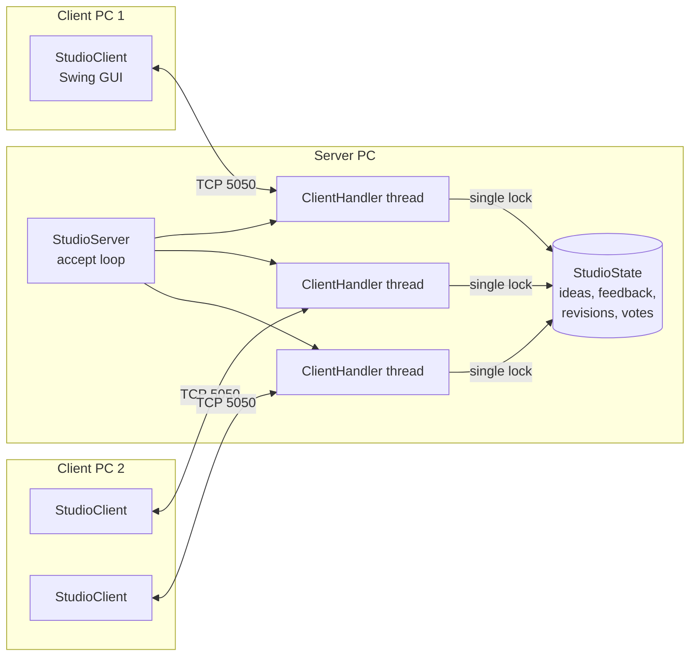

### Source files

| File | Contents |
|---|---|
| `StudioServer.java` | `StudioServer` (accept loop, validation, dispatch, admin console), `ClientHandler` (thread per client), `StudioState` (in-memory data and approval rules), `Protocol` (message format helpers) |
| `StudioClient.java` | Swing GUI (`StudioClient`), custom pink widgets, networking, and an embedded copy of the protocol helpers (`Proto`) |

### Message path (client to server to recipients)

1. The user clicks a button (for example **Send**). The GUI builds a line with `Proto.build(...)`.
2. The line is queued on the client's **single-thread sender executor**, so the GUI never blocks on the network.
3. The server's `ClientHandler` thread for that client reads the line and calls `StudioServer.handle(...)`.
4. `handle` parses the line and, while holding the **single server lock**, validates it and changes `StudioState`.
5. The server broadcasts the result line(s) to every `ClientHandler`. `ClientHandler.send` is `synchronized`, so two broadcasts can never interleave on one socket.
6. Each client's **reader thread** receives the line and hands it to the **Event Dispatch Thread** with `SwingUtilities.invokeLater`, which updates the tables, chat, and panels.

### Threading and safety

- **Server:** one thread per client (cached thread pool). A single `lock` guards the client list and all shared state; all mutations and broadcasts happen under it.
- **Client:** background thread for connecting and reading; a single-thread executor for all writes; every Swing change happens on the EDT.
- **Resynchronization:** after deletes, renames, and edits, the server sends `CLEAR` followed by a full snapshot so all clients stay consistent. New joiners receive the same snapshot.
- **Cleanup:** sockets and streams are closed in `finally` blocks; the server removes a client and announces it when its connection ends.

## 6. Message Format

One message per line: `TYPE|field1|field2|...`

Every field is **URL-encoded**, so `|` and line breaks typed by users can never break the framing. Both server and client use the same `build` / `parse` helpers.

### Client to Server

| Message | Fields | Purpose |
|---|---|---|
| `JOIN` | nickname | Join the studio |
| `MSG` | text | Chat text, or a `/command` |
| `IDEA` | category, title, pitch | New idea card |
| `IDEAUPD` | id, category, title, pitch | Edit an idea |
| `IDEADEL` | id | Delete an idea and everything under it |
| `FBREQ` | ideaId, question | Request feedback (author only) |
| `FBREQUPD` / `FBREQDEL` | id, [question] | Edit / delete a feedback request |
| `FBREPLY` | requestId, comment | Reply to a request |
| `FBREPLYUPD` / `FBREPLYDEL` | id, [comment] | Edit / delete a reply |
| `REVSUBMIT` | ideaId, note | Submit a revision (author only) |
| `REVVOTE` | revisionId, `APPROVE` or `CHANGES`, comment | Vote on a revision |
| `REVUPD` / `REVDEL` | id, [note] | Edit / delete a revision (author only) |

### Server to Client

| Message | Fields | Purpose |
|---|---|---|
| `JOINED` | nickname | Join accepted |
| `NICK` | newNickname | Rename accepted |
| `ERROR` | message | Validation or command error |
| `INFO` | message | System notice (join, leave, activity) |
| `CHAT` | time, nickname, text | A chat message |
| `USERS` | comma-separated nicknames | Online list |
| `BYE` | none | Server confirms `/exit` |
| `CLEAR` | none | Clear client copies before a resync |
| `IDEA` | id, author, category, title, pitch, status | Idea card data |
| `FBREQ` | id, ideaId, author, question | Feedback request data |
| `FBREPLY` | id, requestId, author, comment, time | Reply data |
| `REV` | id, ideaId, title, version, author, note, status, approveCount, changesCount, votes | Revision data |

## 7. Commands

| Command | What it does |
|---|---|
| `/help` | Lists available commands |
| `/ideas` | Lists all idea cards with author and status |
| `/name <newname>` | Changes your nickname (validated; all clients and cards update) |
| `/exit` | Disconnects cleanly |

**Server console (admin, typed in the server window):**

| Command | What it does |
|---|---|
| `help` | Shows admin commands |
| `list` | Lists every idea, request, reply, and revision with its id |
| `delete <idea\|request\|reply\|revision> <id>` | Removes an item (an idea also removes its feedback and revisions) |
| `edit idea <id> <category>\|<title>\|<pitch>` | Rewrites an idea |
| `edit <request\|reply\|revision> <id> <new text>` | Rewrites that item |

## 8. Setup Instructions

### Requirements

| Item | Details |
|---|---|
| Java | JDK 17 recommended (JDK 11 or newer is required for single-file launch). Tested on: `YOUR JAVA VERSION` |
| IDE / build tool | Any IDE, or just the command line. Tested with: `YOUR IDE` |
| Dependencies | None (standard Java library only: `java.net`, `java.io`, `javax.swing`) |
| Network | For the LAN demo, all computers on the same Wi-Fi/LAN |

### Run the server

```bash
java StudioServer.java            # default port 5050
java StudioServer.java 6000       # custom port (1-65535)
```

or compile first:

```bash
javac StudioServer.java StudioClient.java
java StudioServer
java StudioClient
```

The server prints the port and this PC's IP address, and it waits for clients.

### Run a client (start one per user)

```bash
java StudioClient.java
```

### Connect

1. **Server IP:** `localhost` if the client is on the same PC as the server. Otherwise type the **server PC's Wi-Fi IPv4 address**.
2. **Port:** `5050` (or the port you gave the server).
3. **Pen name:** your nickname (1 to 16 characters: letters, digits, `_` `.` `-`).
4. Click **Connect** (or press Enter in the Pen name field).

### Finding the server's IP address (Windows)

```
ipconfig
```

Use the **IPv4 Address** under your active Wi-Fi adapter (for example `192.168.1.23`).

### Troubleshooting

| Problem | Fix |
|---|---|
| "Could not connect to host:port" | Check that the server is running, and that the IP and port are correct. |
| Works on localhost but not from another PC | Allow Java / port 5050 through the server PC's firewall, and make sure both PCs are on the same network. |
| "Nickname already in use" | Pick a different pen name; names are not case-sensitive. |
| "Port already in use" when starting the server | Close the other server instance or start with a different port. |
| Buttons are greyed out | You are not connected, or no table row is selected. |
| "Connection to the server was lost" | The server stopped or the network dropped. Press **Connect** to rejoin (chat history stays on screen). |

> **Note:** All data is kept in server memory for the running session only. Restarting the server clears it.

## 9. How to Use (Quick Tour)

1. **Studio Chat:** type a message and press **Send** or Enter. Use `/help` for commands.
2. **Idea Board:** click **+ New Idea Card**, fill in the category, title, and pitch, then **Add to board**.
3. Select your idea, then click **Request Feedback** and describe what you want reviewed.
4. Other members select the request and click **Reply**.
5. When you have a new draft, select your idea and click **Submit Revision**.
6. **Revisions tab:** reviewers select the revision and click **Approve** or **Request Changes**. Two approvals mark it **Approved**; any change request marks it **Needs Changes**.

## 10. Screenshots

### Connection and chat

| Not connected (controls disabled) | Connected, Studio Chat |
|---|---|
| 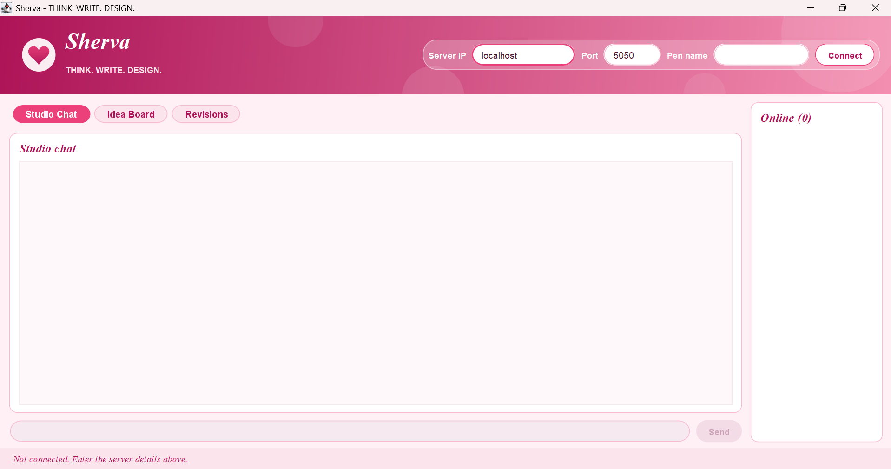 | 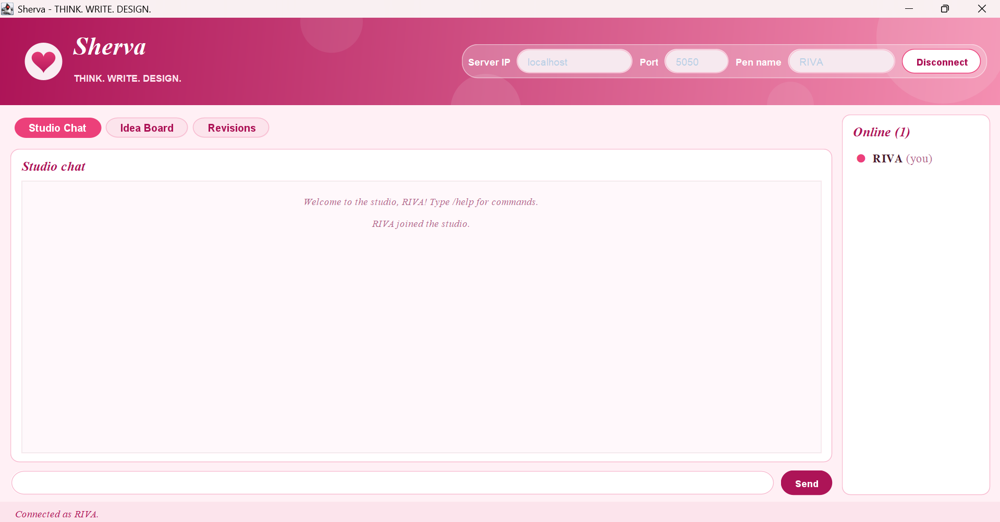 |

**Connection header after joining** (fields locked, button becomes Disconnect):

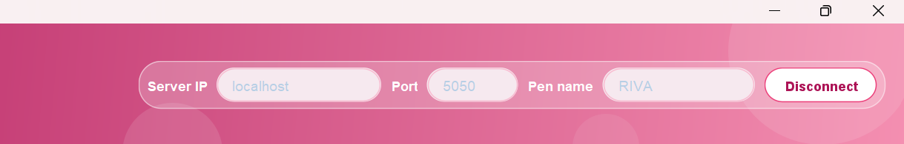

### Idea Board

**Idea Board before connecting** (buttons disabled):

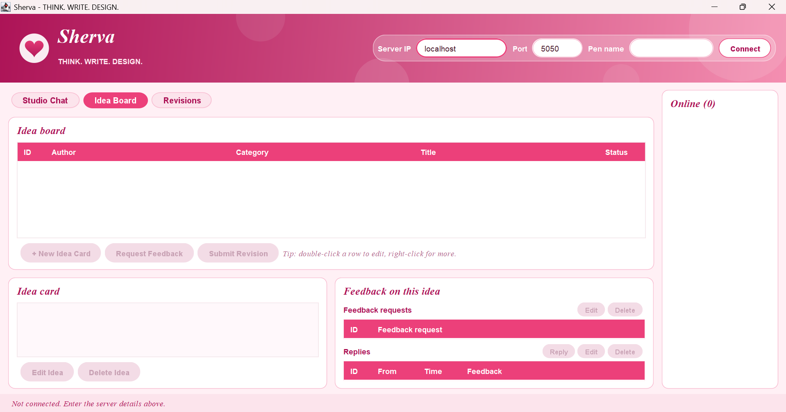

**New Idea Card dialog (blank)** with live character counters:

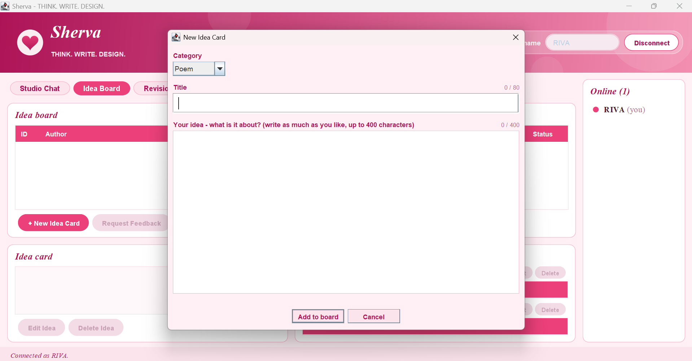

**New Idea Card dialog (filled in):**

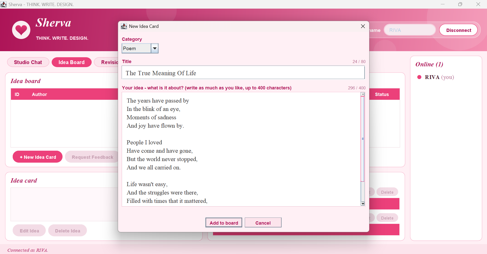

**Idea Board with a card, nothing selected** (row-based buttons are greyed out):

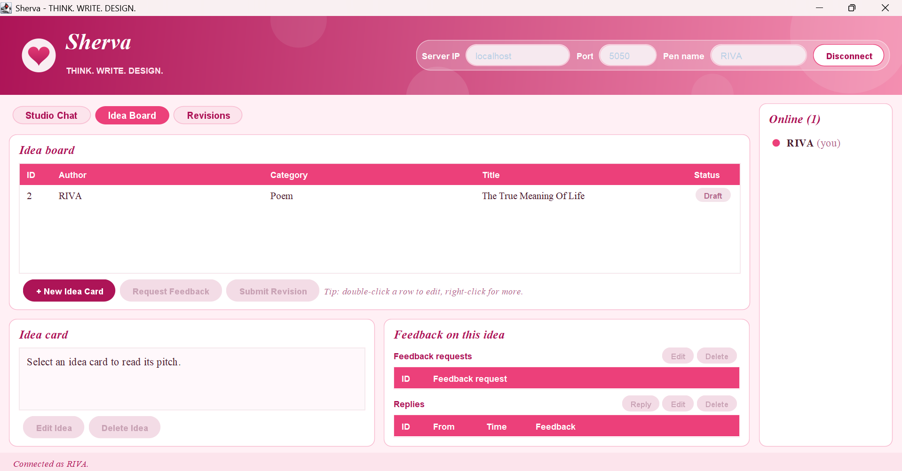

**Idea Board with the card selected** (pitch shown and buttons enabled):

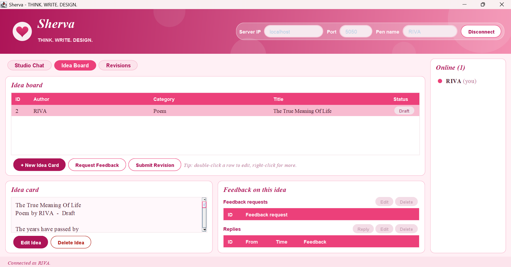

**Request Feedback dialog:**

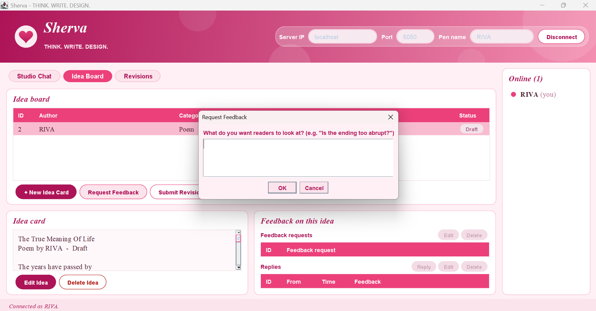

**Feedback requests and replies panels:**

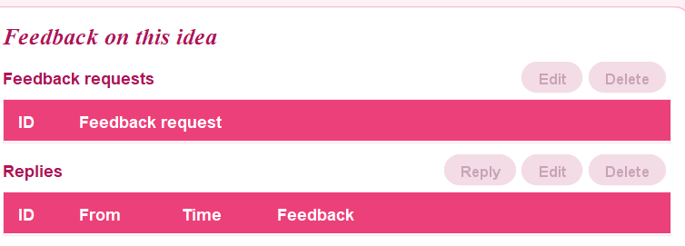

**Edit Idea Card dialog:**

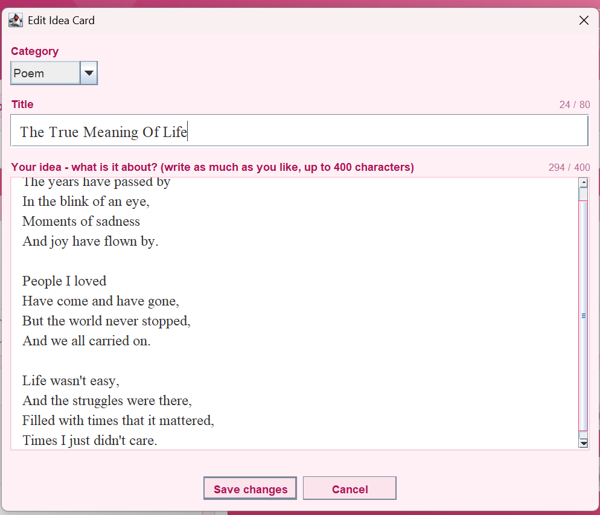

**Delete confirmation** (also removes feedback and revisions):

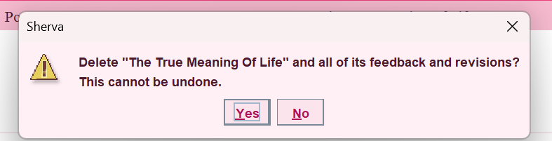

### Revisions

**Submit Revision dialog:**

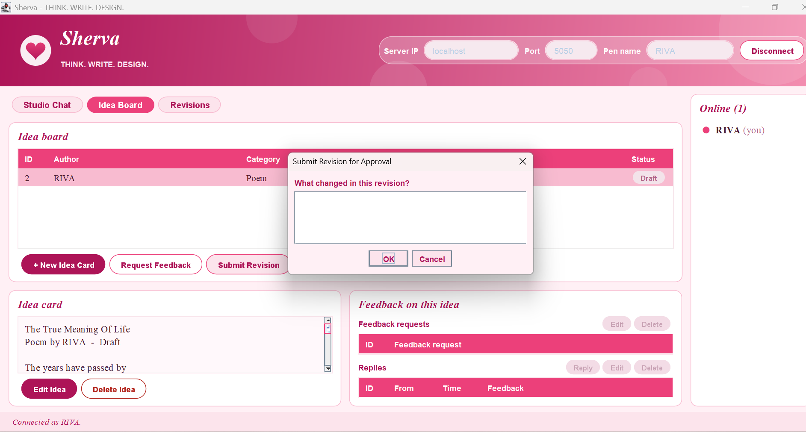

**Revisions tab** (Approve / Request Changes / Edit / Delete):

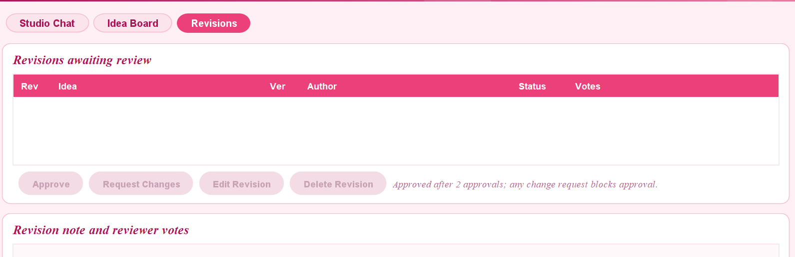

**Revisions tab before connecting:**

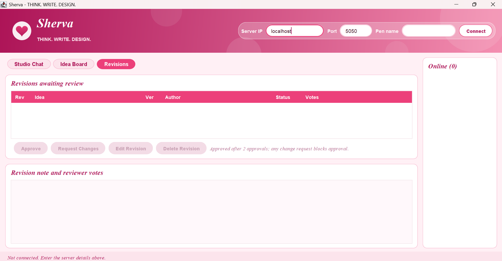

> ☐ **To add before submitting:** screenshots of three clients chatting at once, two computers connected over the LAN, the chat activity log, a duplicate nickname error, and a revision reaching **Approved** / **Needs Changes** (see the test table below).

## 11. Test Results

Test with **three client instances** and **two computers**. Fill in the *Actual result*, *Status*, and *Evidence* columns from your real runs.

| # | Test | Steps | Expected result | Actual result | Status | Evidence |
|---|---|---|---|---|---|---|
| 1 | Three concurrent clients | Start the server, then connect 3 clients with different names | All three join; **Online (3)** shows all names on every client | | ☐ Pass ☐ Fail | |
| 2 | Message broadcast | Client A sends "hello" | All three clients (including A) show it once, with name and time | | ☐ Pass ☐ Fail | |
| 3 | Online list updates | Connect and disconnect clients | List and count update on all clients; "joined" and "left" notices appear | | ☐ Pass ☐ Fail | |
| 4 | Valid nickname change | `/name Ana2` | "You are now Ana2"; others see "X is now known as Ana2"; list updates | | ☐ Pass ☐ Fail | |
| 5 | Duplicate nickname (join) | Connect a second client using a name already online | Error dialog "Nickname '...' is already in use"; not connected | | ☐ Pass ☐ Fail | |
| 6 | Duplicate / invalid nickname (rename) | `/name` with a taken or invalid name | Error shown in chat; nickname unchanged | | ☐ Pass ☐ Fail | |
| 7 | Blank message rejected | Press Send with an empty box | Nothing is sent; status says a blank message cannot be sent | | ☐ Pass ☐ Fail | |
| 8 | Invalid port | Enter `abc` or `70000` as the port, then Connect | Dialog: "Port must be a number between 1 and 65535" | | ☐ Pass ☐ Fail | |
| 9 | Blank / invalid IP | Leave the IP blank, or enter `999.1.1.1` | Blank: "Enter the server IP address". Invalid: "Could not connect" dialog; the GUI stays responsive | | ☐ Pass ☐ Fail | |
| 10 | Server unavailable | Connect while the server is not running | "Could not connect ... make sure the server is running" dialog; no freeze | | ☐ Pass ☐ Fail | |
| 11 | Clean `/exit` | Type `/exit` (or click Disconnect) | Client disconnects; others see "X left the studio" | | ☐ Pass ☐ Fail | |
| 12 | Abrupt disconnection | Kill one client process or unplug its network | Server stays up; others see "X left"; list updates | | ☐ Pass ☐ Fail | |
| 13 | Chat continues | After test 12, remaining clients chat | Messages still reach everyone | | ☐ Pass ☐ Fail | |
| 14 | Server lost | Stop the server while clients are connected | Client shows "Connection ... was lost"; GUI stays open; Connect can rejoin | | ☐ Pass ☐ Fail | |
| 15 | Idea card sync (2 clients) | Client A creates an idea | The card appears on Clients B and C with status Draft | | ☐ Pass ☐ Fail | |
| 16 | Author-only feedback request | Client B selects A's idea and clicks Request Feedback | "Only the idea's author can request feedback" | | ☐ Pass ☐ Fail | |
| 17 | Feedback reply sync | A requests feedback; B replies | The reply appears on A and C under the request | | ☐ Pass ☐ Fail | |
| 18 | Revision workflow (2 clients) | A submits a revision; B approves; C requests changes | Status goes Pending, then Needs Changes; counts update everywhere | | ☐ Pass ☐ Fail | |
| 19 | Approval | After A edits the revision (votes clear), B and C approve | Status becomes **Approved**; the idea card shows Approved | | ☐ Pass ☐ Fail | |
| 20 | Own-revision vote blocked | A tries to vote on A's revision | "You cannot vote on your own revision" | | ☐ Pass ☐ Fail | |
| 21 | Delete idea cascade | Delete an idea | Idea, its feedback, and its revisions disappear on all clients | | ☐ Pass ☐ Fail | |

## 12. Contribution Log

Both members contribute code from their own GitHub accounts. Add dated tasks with commit links.

### Riva Mae D. Carbonera (`@rivamae08`)

| Date | Task | Commit link |
|---|---|---|
| `2026-11-25` | | |


### Sherwin P. Gorero (`@gorerosherwin-coder`)

| Date | Task | Commit link |
|---|---|---|
| `2026-11-25` | | |

### Milestones

| Checkpoint | Date | Status |
|---|---|---|
| 1. Theme and concept approval | | ☐ |
| 2. Working server and multi-client group chat | | ☐ |
| 3. Integrated original features and testing | | ☐ |
| 4. Final submission and demonstration | Nov 23-27, 2026 | ☐ |

## 13. Credits and Disclosures

- Built with the Java standard library only (`java.net`, `java.io`, `java.util.concurrent`, Swing).
- Libraries, assets, tutorials reused: `LIST ANY, OR WRITE "None"`.
- AI assistance used: `DESCRIBE WHAT WAS USED AND FOR WHAT, OR WRITE "None"` (the course requires citing any AI assistance).

## 14. Repository Layout

```
ITAS1-BSIT2B-SD-Carbonera-Gorero/
├── StudioServer.java
├── StudioClient.java
├── README.md
└── screenshots/
    ├── 01-chat-not-connected.png
    ├── 02-idea-board-not-connected.png
    ├── 03-revisions-not-connected.png
    ├── 04-chat-connected.png
    ├── 05-new-idea-dialog-blank.png
    ├── 06-new-idea-dialog-filled.png
    ├── 07-idea-board-no-selection.png
    ├── 08-idea-board-row-selected.png
    ├── 09-request-feedback-dialog.png
    ├── 10-submit-revision-dialog.png
    ├── 11-feedback-panels.png
    ├── 12-edit-idea-dialog.png
    ├── 13-revisions-tab.png
    ├── 14-connection-header.png
    └── 15-delete-idea-confirm.png
```
